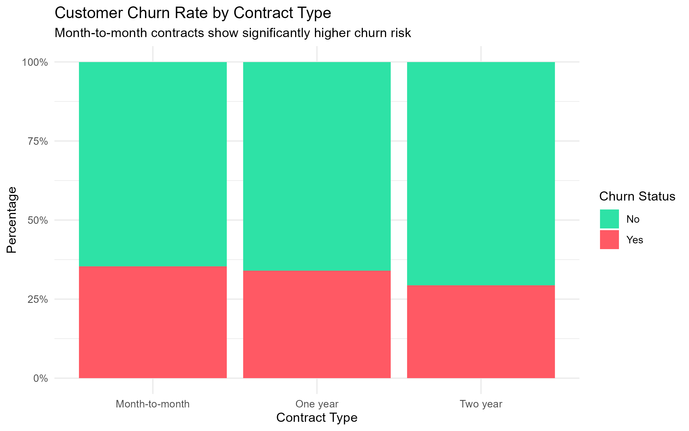
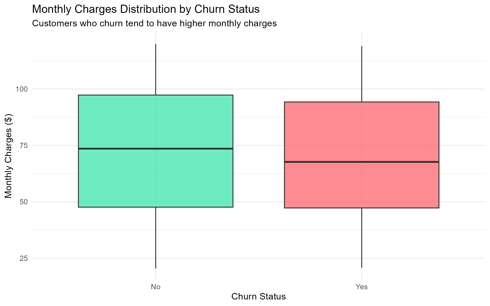

# 📊 Customer Churn Analysis & Risk Prediction

A end-to-end data science project built with **R** and **tidyverse** to analyze customer churn patterns in the telecommunications industry and predict customer churn using Logistic Regression.

---

## 🎯 Business Problem
Customer retention is crucial for telecommunication companies as acquiring a new customer costs 5x to 25x more than retaining an existing one. The objective of this project is to identify key risk factors driving customer churn and build a statistical model to quantify churn probabilities.

---

## 🛠️ Tech Stack & Libraries
* **Language:** R
* **Data Manipulation:** `dplyr`, `tidyr`, `tidyverse`
* **Data Visualization:** `ggplot2`
* **Statistical Modeling:** Logistic Regression (`glm`)

---

## 🔑 Key Findings & Insights
1. **Contract Type Impact:** Customers on **Month-to-month** contracts show a significantly higher churn risk compared to long-term contract holders.
2. **Monthly Charges Effect:** Higher monthly charges positively correlate with customer churn, indicating price sensitivity among short-term users.
3. **Tenure Relationship:** Customer loyalty increases exponentially after the **12-month** tenure threshold.

---

## 📈 Visualizations

### 1. Churn Rate by Contract Type


### 2. Monthly Charges Distribution


---

## 🚀 How to Run
1. Clone this repository:
   ```bash
   git clone [https://github.com/aysefeyzaeraslann-commits/customer-churn-analysis.git](https://github.com/aysefeyzaeraslann-commits/customer-churn-analysis.git)